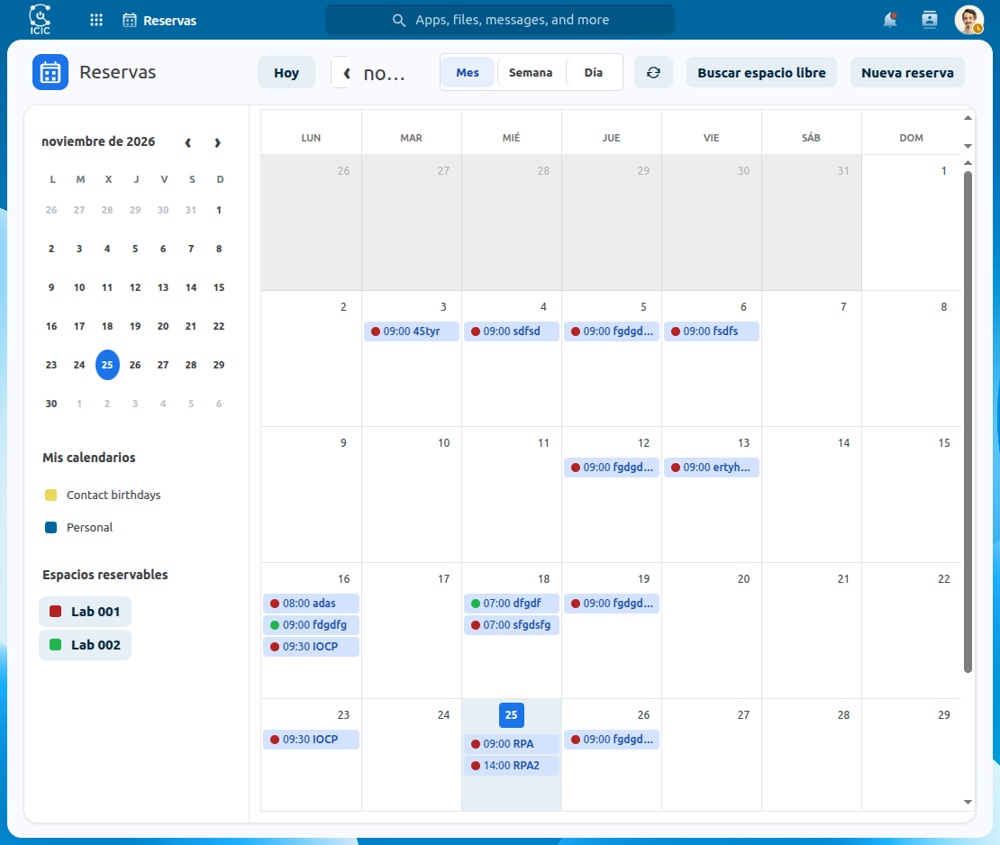
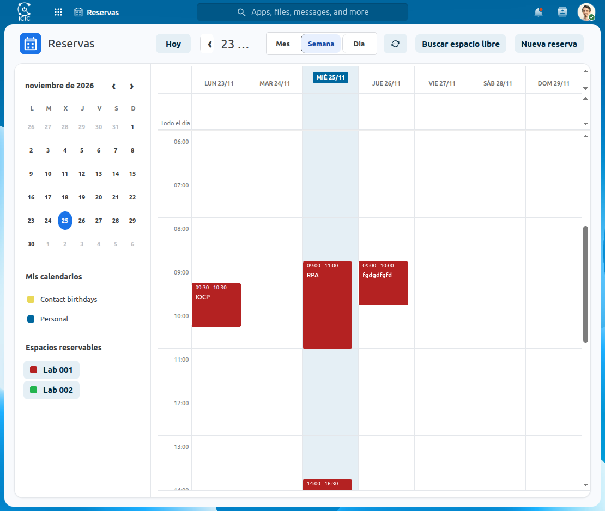
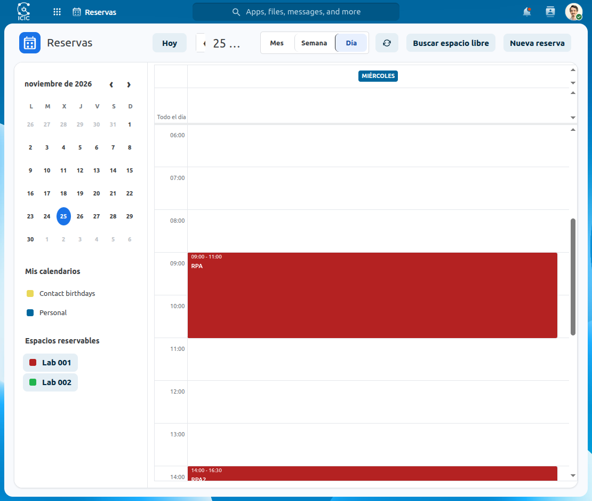
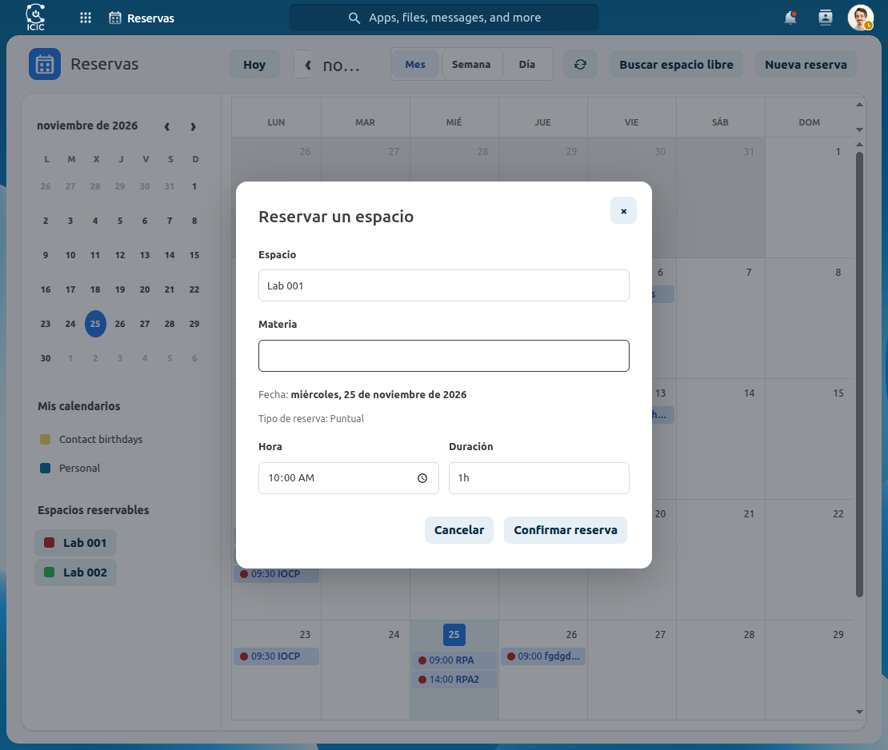
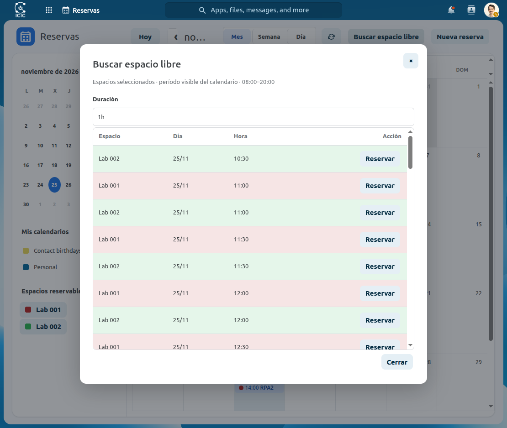
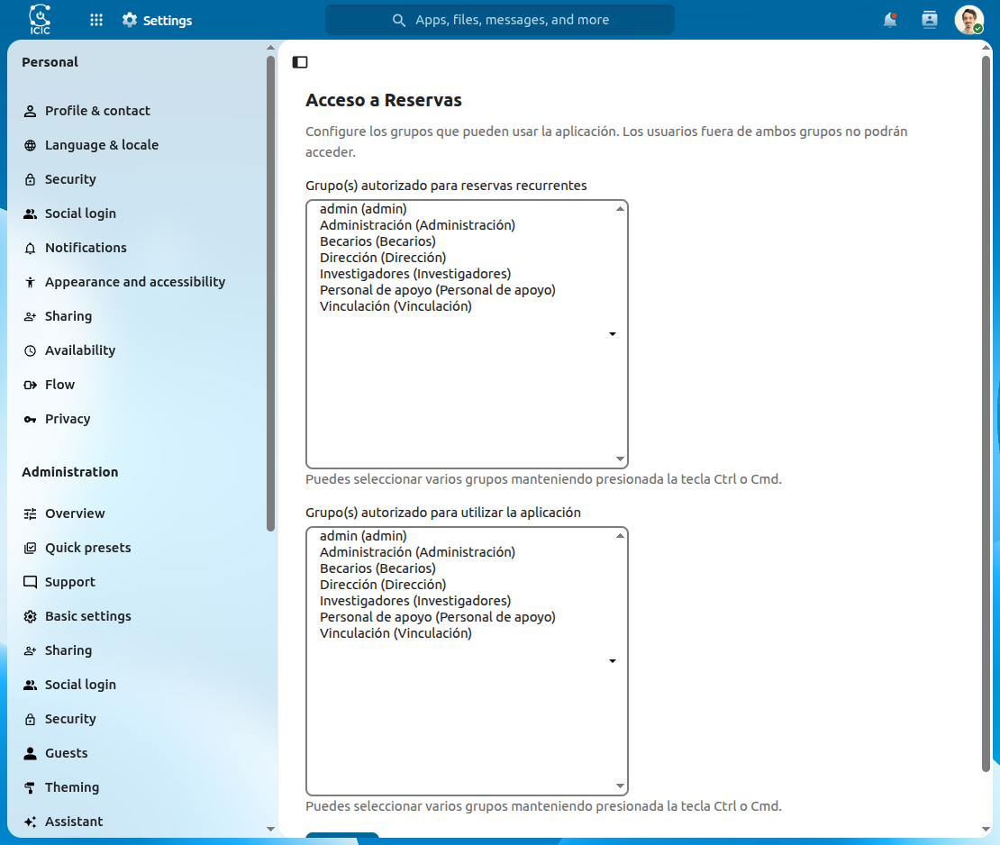

# Reservas

**Reservas** integra los calendarios de Nextcloud con los espacios configurados
en **Calendar Resource Management**. Permite consultar la agenda, buscar
horarios libres, crear y gestionar reservas y distinguir las reservas hechas
para una persona desde las hechas por otra.

## Capturas

### Calendario

### Vista semanal

### Vista diaria

### Nueva reserva

### Buscar espacios libres

### Configuración de grupos

## Requisitos

- Nextcloud 34–35 y PHP 8.3–8.6.
- Las aplicaciones **Calendar** y **Calendar Resource Management** activadas.
- Salas creadas en Calendar Resource Management.
- La cuenta de cada persona debe tener un correo electrónico válido en su perfil
  para identificar a quien organiza la reserva y habilitar enlaces de correo.

## Acceso y permisos

- Los administradores pueden utilizar la aplicación sin pertenecer a un grupo.
- En **Ajustes de administración > Reservas** se pueden configurar dos grupos:
  - **Uso de la aplicación**: permite acceder a calendarios y espacios.
  - **Reservas recurrentes**: permite crear reservas semanales y reservar a
    nombre de otras personas.
- Los usuarios sin permiso reciben una vista de acceso denegado.

## Calendario

- Se ofrece una vista mensual, semanal y diaria.
- Incluye un calendario miniatura para navegar rápidamente entre meses.
- Los eventos propios y las reservas de los espacios se muestran en la misma
  vista.
- Cada espacio tiene un color propio en la leyenda de espacios.
- Se puede activar o desactivar individualmente cada sala para filtrar la agenda.
- Al seleccionar un día se abre directamente la reserva con esa fecha.
- Al seleccionar un intervalo en la agenda también se propone la hora y duración
  correspondientes.
- Si queda seleccionado un solo espacio, ese espacio se propone automáticamente
  al crear una reserva.
- Se puede actualizar manualmente la lista de calendarios y espacios.

## Crear reservas

Desde **Nueva reserva** o desde una selección del calendario se puede indicar:

- Espacio.
- Materia o título.
- Fecha y hora.
- Duración: 30 minutos, 1 hora o incrementos de media hora hasta 8 horas.
- Reserva puntual o período continuo semanal.
- Último día de un período continuo, respetando el mismo día de la semana.

El último día elegido para una reserva continua se recuerda por sesión y se
propone al repetir una reserva del mismo día de semana.

Los usuarios con el permiso recurrente pueden reservar para otra persona:

- El usuario elige el destinatario en el campo **Reservar para**.
- La reserva almacena tanto al destinatario como a quien la creó.
- En la reserva se muestra el nombre de la persona para quien fue hecha.
- En los detalles y mensajes de conflicto se incluye un enlace `mailto:` para
  escribir al destinatario o al creador correspondiente.

Las reservas se escriben directamente en el calendario del espacio
(`principals/calendar-rooms/.../calendar`). La materia, el tipo de reserva,
el creador y el destinatario quedan registrados en la descripción del evento.

## Buscar espacios libres

**Buscar espacio libre** consulta los eventos de los espacios seleccionados para
el período visible en el calendario.

- Permite elegir una duración.
- Busca huecos cada 30 minutos entre las 08:00 y las 20:00.
- Descarta horarios pasados y intervalos que superponen eventos existentes.
- Muestra espacio, día y hora de cada resultado.
- Permite iniciar una reserva directamente desde un horario encontrado.

## Colisiones y notificaciones

Antes de crear o modificar una reserva, la aplicación verifica puntualmente o
semanalmente todos los intervalos afectados.

Si existe una superposición:

- Se rechaza la reserva o actualización.
- Se muestra la reserva existente y el nombre de su destinatario o creador.
- El nombre se convierte en enlace de correo cuando hay una dirección válida.
- Se envía una notificación Nextcloud a los organizadores de las reservas que
  ya ocupaban el intervalo.

## Detalles, edición y eliminación

Al abrir un evento se muestran su materia o título, destinatario, creador,
correo electrónico, espacio, tipo, fecha y hora.

- Las reservas puntuales pueden editarse desde su detalle.
- Las reservas semanales muestran hasta qué fecha se repiten.
- Las modificaciones de una serie continua se aplican a toda la serie.
- Solo quien creó una reserva puede eliminarla.
- Eliminar una reserva semanal elimina toda la serie.
